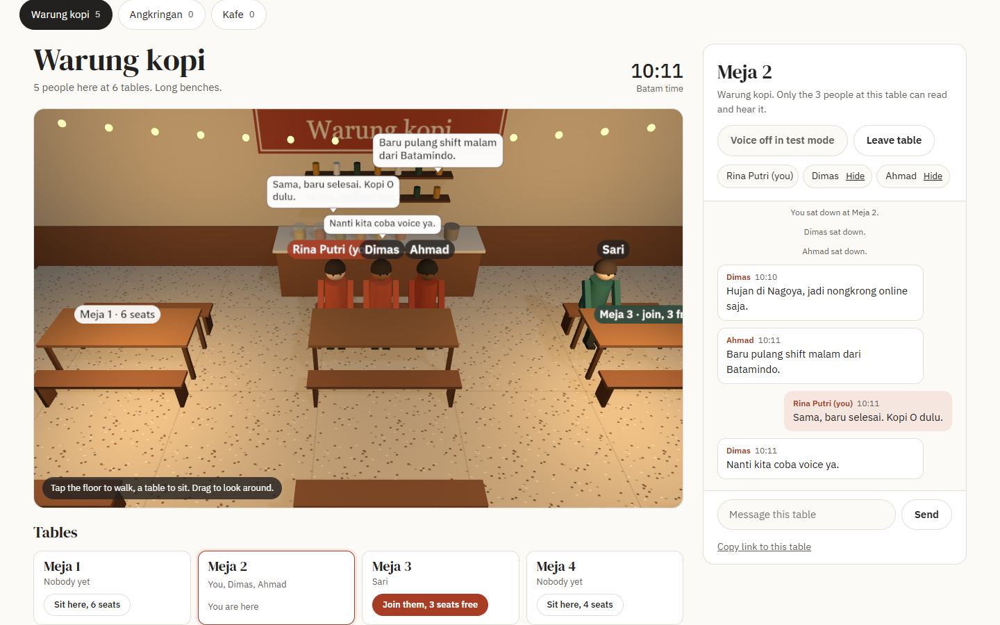
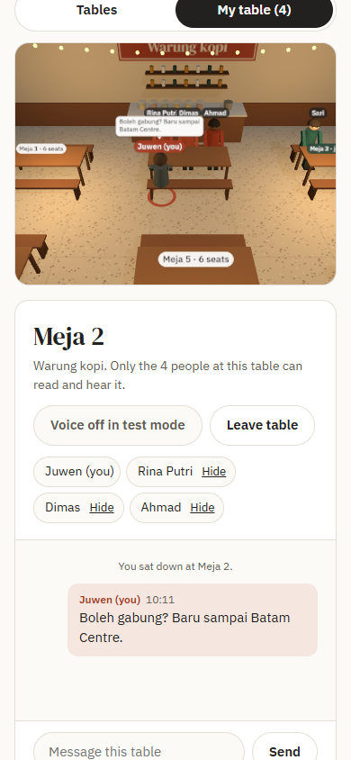

# Nongkrong

**Walk into a 3D warung, kopitiam, angkringan, pub or cafe for your city and sit down at a table. Only the people at your table can read your messages or hear your voice.**

Live: https://juw12.github.io/nongkrong/

Nongkrong (Indonesian for "hanging out") is a free, no-account place to chill with people near you after work.
Pick your country and city, choose the kind of place people there actually sit in (warung kopi, angkringan,
mamak, kopitiam, kissaten, izakaya, pub, biergarten, diner and more), then walk in as a 3D avatar, see who is
already there, and sit at a table. Text chat and voice stay inside the table.





## What it does

- **Walk around in 3D (three.js).** Each place is a small 3D scene you walk through: tap the floor or use WASD and
  the arrow keys, drag to look around, pinch or scroll to zoom. Tap a table and your avatar walks over and sits on a
  free stool. Everyone else in the same place walks and sits live in front of you.
- **Six kinds of place, built for the local culture.** Warung kopi with long benches and jars on the counter,
  kopitiam with round marble tables on a green and white checker floor, angkringan with woven mats, low tables and a
  night cart, street stalls with plastic stools, an izakaya or cafe counter with bar stools, and a beer garden on grass
  with string lights.
- **23 countries plus "Anywhere", 107 cities and regions, 69 places.** Each region picks the place types people
  there actually hang out in.
- **Day and night follow the city's clock.** The sky, sun and lamps follow the local time of the region you pick, so
  a Batam angkringan at 9 pm is dark with the lantern lit.
- **Speech bubbles at your table.** What your table-mates write pops up above their heads, and it only appears for
  people at that table.
- **Table-only chat.** Messages go to the people at your table and nobody else.
- **Table-only voice.** Turn on voice and only your table-mates hear you. Mute, unmute or turn it off at any time.
  A green ring under an avatar shows who is in voice and pulses while they talk.
- **Table list too.** Under the 3D view, every table is listed with who sits there and how many seats are free,
  so you can also pick a table by keyboard or screen reader. Full tables refuse new sitters, and if two people grab
  the same stool, the one who sat first keeps it.
- **Local time.** The clock shows the time in the region on screen, so you know if people there are on lunch or on a night shift.
- **Share a table.** "Copy link to this table" makes a link that drops a friend at the same table.
- **Hide a person.** Hide anyone at your table and their messages and voice stop reaching you.
- **Light and dark theme.** Works on phones, installs as an app (PWA), and the app shell works offline.

## How it works (and what that means for privacy)

There is no server and no account.

- Your name and last city are stored only in your browser (localStorage).
- Browsers find each other through public **Nostr relays** using [Trystero](https://github.com/dmotz/trystero) (MIT,
  bundled in `vendor/`). The relays only pass the WebRTC handshake, which is encrypted with a key derived from the room name.
- After that, **text and voice go directly from browser to browser** over WebRTC (DTLS/SRTP encryption).
- Each city is one presence room: names, seats and where your avatar stands in the place (a few small position
  updates per second while you walk). Each table is its own room for chat and voice, so people at other tables
  never receive your messages or audio.
- Nothing is recorded or saved. Leave the table and the chat is gone.

## Limits (honest list)

- Rooms are public: anyone who picks the same city can see your chosen name and seat.
- There is no TURN relay server, so on some strict networks (some office or mobile networks) two browsers cannot
  connect directly and will not see each other.
- Voice uses a full mesh between table-mates, which is why tables have 2 to 8 seats.
- Moderation is personal (Hide). There are no accounts, so there are no bans.
- Text messages are limited to 400 characters and a few per second.
- The 3D view needs WebGL. Without it (or with `?flat=1`) the app falls back to the 2D table plan and still works.

## Run it yourself

It is a static site. Serve the folder with any web server:

```
python -m http.server 8000
```

Then open http://localhost:8000/. Add `?local=1` to try it alone across several tabs of one browser
(BroadcastChannel instead of the network; text only). Add `&hour=21` to see a place at night.

## Tests

```
python tests/e2e_local.py    # 3 tabs, local mode: 3D walking synced, tap a 3D table to sit, bubbles only at your
                             # table, table-only chat, full tables, hide, 390/1440 px overflow, JS errors (21 checks)
python tests/probe_3d.py     # screenshots of each kind of place by day and night
python tests/e2e_online.py   # 3 separate browsers over the real Nostr relays with fake microphones
```

Both need Python with Playwright and Chrome or Chromium.

## Files

| File | What |
|---|---|
| `index.html`, `app.css`, `app.js` | the app |
| `world.js` | the 3D place: venues, furniture, avatars, walking, sitting, bubbles, day and night |
| `data.js` | countries, regions, time zones, venue types and floor plans |
| `net.js` | online (Trystero/Nostr) and local (BroadcastChannel) transports |
| `design.md` | design system: palette, type, banned defaults |
| `sw.js`, `manifest.webmanifest`, `icon*` | installable app and offline shell |

## License

MIT. three.js (r160), Trystero and noble-secp256k1 in `vendor/` are MIT licensed by their authors.
